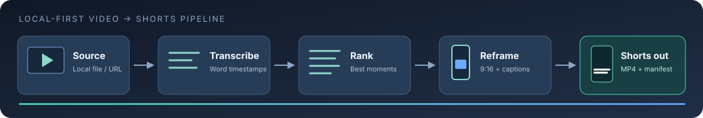

# ClipRally

**Turn a long video you are allowed to edit into captioned vertical clips — on your own computer.**

**Project website:** https://voyager67.github.io/cliprally/ · The site is the product guide; video processing runs locally on your computer.

ClipRally is an open-source, local-first video-to-shorts workflow for creators, editors, and developers. Give it a video file. It transcribes the speech, finds candidate moments, ranks them, reframes them for 9:16, adds word-highlight captions, and exports MP4s with editable title and hashtag suggestions.

<p align="center">
  
</p>


## The product: local video to finished Shorts

The main ClipRally workflow does **not** need an OpenAI key, Gemini key, YouTube API key, social account, hosted AI service, or paid clipping credits. Processing happens on the computer running ClipRally.

1. **Choose a local video** you created, licensed, or have permission to edit.
2. **Analyse the source** with local Faster-Whisper speech timestamps, OpenCV visual-activity signals, or both.
3. **Find and rank moments** using transcript and/or visual evidence. No hosted LLM account is required.
4. **Create a vertical composition** with a 9:16 crop. Optional face-centering can follow the largest detected face.
5. **Burn in word-highlight captions** and render an MP4 with FFmpeg.
6. **Review and export** clips, a processing manifest, and editable title/hashtag suggestions.

<blockquote>
  **Local-first means your media stays local during the core workflow.** The Whisper model is downloaded the first time you use it; after it is cached, transcription runs locally. No hosted AI API is used by the default workflow.
</blockquote>

## Get started

### Requirements

- Python 3.10 or newer.
- FFmpeg and FFprobe available on your system `PATH`.
- A supported video file and enough disk space for the source, model cache, and rendered clips.
- Internet access for the first Faster-Whisper model download; internet is not needed for later local runs when the model is cached.

Install FFmpeg:

| Operating system | Command |
|---|---|
| Windows | `winget install Gyan.FFmpeg` |
| macOS | `brew install ffmpeg` |
| Ubuntu/Debian | `sudo apt-get update && sudo apt-get install -y ffmpeg` |

Close and reopen the terminal after installing FFmpeg, then check:

```bash
ffmpeg -version
ffprobe -version
```

### Install ClipRally

```bash
git clone https://github.com/voyager67/cliprally.git
cd cliprally
python -m venv .venv
```

Activate the environment:

```powershell
# Windows PowerShell
.venv\Scripts\Activate.ps1
```

```bash
# macOS / Linux
source .venv/bin/activate
```

Install the core local workflow and the optional browser interface:

```bash
python -m pip install --upgrade pip
python -m pip install -e ".[transcription,visual-analysis,ui]"
cliprally check
```

### Option A: use the browser interface

This is the easiest way to try ClipRally without learning the CLI:

```bash
cliprally-ui
```

The app opens a local Streamlit page. Select a local file or upload one, confirm that you have the rights to edit it, choose the number and length of clips, and press **Create my clips**. Preview the results and download MP4s and JSON metadata.

Run the interface on a computer you control and keep it bound to localhost. Do not expose the Streamlit server to the public internet.

### Option B: use the command line

```bash
cliprally clip \
  --input ./media/my-video.mp4 \
  --output ./clips \
  --clips 3 \
  --model-size small \
  --scorer heuristic \
  --moment-mode hybrid
```

PowerShell:

```powershell
cliprally clip --input .\media\my-video.mp4 --output .\clips --clips 3 --model-size small --scorer heuristic --moment-mode hybrid
```

The first run downloads the selected Whisper model. `small` is a practical starting point; try `tiny` or `base` on lower-powered machines. The default video encoder is portable software H.264 (`libx264`). GPU encoding is optional and depends on the FFmpeg build and installed driver.

### What gets exported

```text
clips/
├── 01-a-strong-opening.mp4
├── 02-a-clear-payoff.mp4
├── 03-a-useful-moment.mp4
├── manifest.json
└── metadata.json
```

Each MP4 is rendered at 1080×1920 with H.264 video and AAC audio when the source has audio. Captions are word-highlighted unless `--no-captions` is supplied. The manifest records source details, selected timestamps, ranking scores and reasons. It includes the source file path, so inspect it before sharing. `metadata.json` contains editable title and hashtag suggestions; they are simple transcript-based suggestions, not a promise of reach or virality.

## What works in the core workflow

| Capability | Default behaviour | External API required? |
|---|---|---|
| Local video input | FFmpeg-readable video files | No |
| Transcription | Faster-Whisper, local inference with word timestamps | No hosted API |
| Moment selection | Transcript ranking, plus optional visual-activity windows in hybrid/visual mode | No |
| Visual activity | OpenCV optical flow and shot-change heuristics | No hosted API |
| 9:16 rendering | FFmpeg portrait output | No |
| Captions | Word-timed ASS karaoke subtitles | No |
| Title and hashtag suggestions | Offline transcript-based suggestions | No |
| Processing manifest | JSON timings, scores, source and output details | No |

The ranking score is an editing aid, not a prediction of virality. The built-in vocabulary works best for English. Other languages can be transcribed, but the scores and captions should be reviewed manually.


## Visual highlight detection (gameplay and action footage)

ClipRally can also analyse the pictures in a video, not only its transcript. Install the OpenCV extra (included in the `all` extra):

```bash
python -m pip install -e ".[visual-analysis]"
```

Choose one of three moment modes:

- `transcript` — existing speech-first segmentation and ranking. This remains the CLI default for backwards compatibility.
- `hybrid` — combines transcript ranking with visual activity. Use this for streams with commentary, podcasts with changing camera shots, and mixed content.
- `visual` — skips Whisper and finds high-motion / shot-change windows. This works on silent recordings and is useful for gameplay or other action-heavy footage.

Examples:

```bash
# Recommended for a creator stream with commentary
cliprally clip --input ./media/stream.mp4 --output ./clips --moment-mode hybrid --clips 5

# For silent gameplay or action footage
cliprally clip --input ./media/gameplay.mp4 --output ./clips --moment-mode visual --clips 5
```

The first implementation uses local OpenCV optical flow and grayscale-histogram changes sampled at a configurable interval (`--visual-sample-interval`, default 1.5 seconds). The detector ranks windows with sustained motion and scene changes, then avoids returning many near-duplicate time ranges. In the browser UI, choose **Hybrid — speech + visual activity** or **Visual activity only**.

**Important limitation:** this is activity detection, not semantic understanding. It can surface rapid movement, camera changes, and action-heavy sections even when nobody speaks. It does not know that a GTA clip contains a kill, race win, stunt, or funny moment; it cannot identify an actor or locate a named scene in a film. High motion can also mean an unimportant camera pan or transition. Review every result. Visual-only clips have no word captions unless a transcript is supplied through a future multimodal workflow.

## Optional local AI ranking with Ollama

The default heuristic ranker is the simplest and most predictable option. For local LLM-assisted ranking, install and run [Ollama](https://ollama.com/) separately:

```bash
ollama pull qwen2.5:7b
ollama serve
cliprally clip --input ./media/talk.mp4 --output ./clips --scorer ollama --scorer-model qwen2.5:7b
```

Ollama does not require a hosted AI API key. The model must fit your available RAM/VRAM. LLM ranking sends transcript text to the local Ollama server; the media is still rendered locally.

## Optional extensions

These features are separate from the primary local-file workflow. They are not required to install ClipRally or create clips.

### URL ingestion

Install the optional `yt-dlp` integration:

```bash
python -m pip install -e ".[transcription,url-ingest]"
cliprally clip --url "https://www.youtube.com/watch?v=VIDEO_ID" --output ./clips --clips 3 --i-have-rights
```

URL fetching is best-effort. Site extractors can break, sites can require authentication, and availability depends on platform rules. ClipRally does not bypass DRM, paywalls, private access controls, or download restrictions. A public link is not permission to repost its contents. When in doubt, use a local file you are authorized to edit.

### Face-centred crop

Install OpenCV and enable the optional face-centering heuristic:

```bash
python -m pip install -e ".[transcription,face-tracking]"
cliprally clip --input ./media/interview.mp4 --output ./clips --face-tracking
```

This samples frames and uses a Haar face detector to centre the largest detected face, smoothing between positions. It is **not** active-speaker detection and cannot reliably determine which person is speaking. If no face is detected, rendering falls back to a centred crop. Automatic gameplay/facecam split-screen is not included.

### RSS and channel-feed discovery

Discovery lists items for manual review; it does not automatically download, edit, or repost them.

```bash
cliprally trends --feed "https://example.com/feed.xml" --limit 20
```

YouTube channel RSS feeds can be used without a YouTube Data API key:

```bash
cliprally trends \
  --feed "https://www.youtube.com/feeds/videos.xml?channel_id=CHANNEL_ID" \
  --limit 20
```

The YouTube `mostPopular` chart requires a Data API key and may not represent a universal Trending feed. See the [YouTube Data API revision history](https://developers.google.com/youtube/data/revision_history).

### Optional hosted model scorers

OpenAI Responses API and Gemini scoring adapters are available for users who explicitly choose hosted inference. They are not used by default. They send transcript candidate text to the selected provider, so do not use them with confidential content unless that transfer is acceptable. Provider model IDs, permissions, and pricing can change; use `--scorer-model` to select an available model. See the [OpenAI model guide](https://developers.openai.com/api/docs/models) and [Gemini model documentation](https://ai.google.dev/gemini-api/docs/models).

### MCP server

Install the optional MCP dependency and launch the local stdio server:

```bash
python -m pip install -e ".[mcp,transcription]"
cliprally-mcp
```

The server exposes local video inspection and local-file clipping. It does not fetch URLs or publish to social accounts. The caller must explicitly confirm it is authorized to use the source media. Only connect MCP servers and clients you trust; the server has the filesystem permissions of the user running it.

### Social publishing adapters

YouTube, TikTok and Instagram adapters are optional integrations, not part of the core clipping path. They require developer apps, OAuth or access tokens, platform approval/permissions, and account eligibility. Instagram Reels publishing additionally requires a publicly accessible HTTPS video URL; ClipRally does not host videos. Uploads are explicit operations and are never triggered by clipping or trend discovery.

The adapters have automated tests using mocked provider responses. They have **not** been certified against live social accounts in this project environment. Platform review, account eligibility, media requirements, API changes and moderation remain outside ClipRally's control. Read the separate [platform integration notes](docs/platform-integrations.md) before configuring an account.

## Privacy and responsible use

- The default core path processes the video and transcript locally. The initial Whisper model download is the only routine network step in that path.
- URL ingestion contacts the source platform. Hosted scorers transmit transcript candidate text to the provider you select. Social publishing transmits the clip and metadata to that platform.
- Never expose the local browser interface or MCP server to an untrusted network.
- Only edit and publish media you created, licensed, or have permission to use. A short excerpt is not automatically fair use or platform-compliant. You are responsible for copyright, publicity/privacy, music, monetization and platform-policy compliance.
- Review every generated clip, caption, title and hashtag before posting.

## Development and validation

```bash
python -m pip install -e ".[dev]"
ruff check .
pytest -q
```

Tests use generated synthetic media and mocked provider responses. They do not download other creators' videos or contact live social accounts. The CI workflow runs lint and tests across the supported Python versions. See [the validation record](docs/validation.md), [architecture](docs/architecture.md), [contribution guide](CONTRIBUTING.md), and [security policy](SECURITY.md).

## Current boundaries

ClipRally is focused on dependable local video-to-vertical-clip processing. It is not an autonomous content farm, a copyright-clearing service, or a guaranteed viral-content predictor. Semantic gameplay-event recognition (kills, wins, stunts), named movie-scene search, active-speaker diarization, gameplay/facecam split-screen, automatic social scheduling, and live analytics are not included. Current visual analysis measures motion and shot changes; it does not understand what an event means.

## License

MIT. Whisper models, FFmpeg builds, optional third-party packages, hosted models and platform APIs may have separate licenses or terms. Review those before distribution or commercial use.